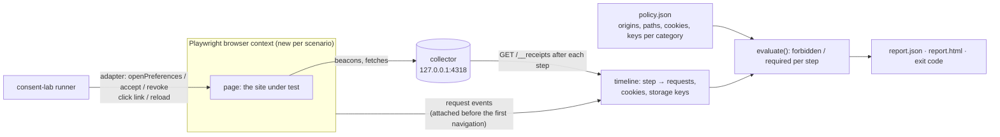

# consent-lab

A visitor accepts analytics, changes their mind and navigates to another page. Does the tracker come back? Run the fixture and inspect the timeline.

[](https://github.com/AutumnTrace/consent-lab/actions/workflows/ci.yml)
[](LICENSE)


consent-lab is a test package for consent behaviour in the browser. You give it three things:

- an **adapter** that knows how to open your consent preferences, accept a category and revoke it;
- a **policy** listing which request origins and paths, cookies and localStorage keys belong to each category;
- a page to start on and an in-app link to follow.

It drives Chromium and Firefox through six scenarios with Playwright and records every request, every event a collector received, and every cookie and storage key after each action. It then writes an HTML evidence report, a JSON report and a CI exit code.

The repository includes a fictional Next.js shop with synthetic trackers to run it against. Three switchable defects in the shop make the harness fail on purpose.

**Try it** (Node 24, pnpm 12):

```sh
git clone https://github.com/AutumnTrace/consent-lab && cd consent-lab
pnpm install && pnpm build
pnpm --filter @autumntrace/consent-lab exec playwright install chromium firefox
pnpm demo --defect reinit-on-navigation      # exits 1; open reports/latest/report.html
```

All trackers here are synthetic. "Pulse" (analytics) and "Beacon Ads" (marketing) are short scripts served by a local collector in [`fixtures/collector`](fixtures/collector), and nothing leaves your machine.

## A 60-second walkthrough

1. **Clean run.** `pnpm demo` starts the collector on `127.0.0.1:4318` and the shop on `localhost:3199`, then runs all six scenarios in both browsers.
   - It prints `12/12 runs passed, 0 violation(s), 1 unclassified request URL(s)` and exits 0.
   - The unclassified URL is the shop's stock widget, which the policy deliberately leaves out. Open `reports/latest/report.html` and look at the *Unclassified requests* table.
2. **The opening question.** Run `pnpm demo --defect reinit-on-navigation`. It exits 1, and `client-side-navigation` fails at step 4, *navigate in the app*.
   - In the report, open *Revoke, then navigate · chromium*. The first violating action says what was expected: no analytics requests from the start of the step through the 1000 ms window. Then it shows the evidence: `POST http://127.0.0.1:4318/collect/analytics (ping, completed 204)`.
   - The step's timeline (above) shows the collector received a `page_view` for `/products`, and the `_pulse_id` cookie came back.
3. **A cookie left behind.** `pnpm demo --defect cookie-after-revoke` fails `revoke` at step 3. The requests stop, but `_pulse_id` is still set after the revocation.
4. **Too early.** `pnpm demo --defect early-pageview` fails every scenario at step 1, `visit`: a page view is sent before the banner has even been answered.
5. **Committed reports.** Compare with the reports in [`reports/`](reports). They come from this build, in both browsers: [clean](reports/clean/report.html), [early-pageview](reports/early-pageview/report.html), [cookie-after-revoke](reports/cookie-after-revoke/report.html) and [reinit-on-navigation](reports/reinit-on-navigation/report.html). GitHub shows HTML as source, so download a report or open your local copy. The `report.json` next to each one is the machine-readable version.

## The scenarios

Every scenario starts in a new browser context with an empty collector. The category under test is `analytics`; `marketing` is the other optional category.

| Scenario | Steps (forbidden ✗ · required ✓) | The question it answers |
| --- | --- | --- |
| `fresh-visit` | visit ✗all | Before any choice, does an optional tracker run? |
| `reject` | visit ✗all → reject all ✗all → navigate ✗all → reload ✗all | After "reject", does anything optional start, here, on the next page, or after a reload? |
| `accept` | visit ✗all → accept analytics ✓analytics ✗marketing → navigate ✓analytics ✗marketing | Does analytics start only after it is accepted, and keep working across a client-side navigation? |
| `revoke` | visit → accept ✓analytics → revoke analytics ✗all | After revoking, do requests stop and cookies and storage go? |
| `client-side-navigation` | … → revoke analytics ✗all → navigate ✗all | Does a client-side navigation bring the tracker back? |
| `full-reload` | … → revoke analytics ✗all → reload ✗all | Does a reload bring it back? |

For a **forbidden** category, a step fails on any of these: an attempted request, an event the collector received, a cookie still set at the end of the step, or a localStorage key still present.

**Required** is a positive control. After *accept*, at least one analytics event must arrive. Without that check, a tracker that silently never loaded would make every revocation scenario pass.

The *navigate* step clicks a real in-app link and fails as a harness error if a new document loads. That way "client-side navigation" really is one.

### Exactly what is observed, and when

- **Surfaces:**
  - every request made by any page or worker in the browser context, recorded from Playwright's `request` events and attached before the first navigation;
  - events received by the collector, when one is configured;
  - all cookies in the context, for every domain;
  - the page origin's localStorage keys that the policy lists. Others are counted, not recorded.
- **Window:** after each action the harness waits a fixed **1000 ms** (`observationWindowMs`), then reads cookies, storage and the collector's receipts.
- **Window start:**
  - Navigations (visit, navigate, reload) count requests from the moment the action starts.
  - Consent changes (accept, revoke, reject all) count from the moment the adapter returns, so an event fired by the Save click itself is not held against the revocation.
- **Attempted vs received:** a request the browser started counts as attempted even if it failed or was blocked. A receipt is what reached the collector. The report shows both side by side.
  - Chromium reports `sendBeacon` requests as `ping`; Firefox reports them as `beacon`.
  - Receipt times come from the collector's clock on the same machine, so a receipt can read a millisecond before the browser's request event.
- **Not observed:**
  - IndexedDB, Cache Storage and sessionStorage;
  - server-side processing;
  - requests after the window closes;
  - browsers other than the ones you run.

## How it decides



The difficult decision is to judge from outside the page. consent-lab never injects code into the site or reads the consent manager's own state. It looks at what the browser actually sent and what the collector actually received, then checks that against a policy you wrote down, step by step.

- Mistakes inside the site's consent code are caught the same way as a misbehaving third-party script.
- The result is evidence a reviewer can read: the request, its time, and the step it followed.
- The policy is a fixture you keep next to your tests and review like code. A request that no category claims is reported as **unclassified**. With `"unclassified": "fail"` it fails the run.

## Failure scenarios and the tests that pin them

The release checks run the real collector, a production build of the shop and the CLI as a user runs it, in Chromium and Firefox ([`tests/release.test.ts`](tests/release.test.ts)). The unit tests cover evaluation and the report on synthetic timelines.

| Scenario | What must happen | Test |
| --- | --- | --- |
| The clean shop | All 12 runs (6 scenarios × 2 browsers) pass, exit 0. | [release: the clean shop](tests/release.test.ts#L38) |
| `early-pageview`: a page view before consent | `fresh-visit` fails at step 1 with `request-attempted` in both browsers, exit 1. | [release: defect early-pageview](tests/release.test.ts#L49) |
| `cookie-after-revoke`: `_pulse_id` survives revocation | `revoke` fails at step 3 with `cookie-present` in both browsers, exit 1. | [release: defect cookie-after-revoke](tests/release.test.ts#L49) |
| `reinit-on-navigation`: the route listener restarts the tracker | `client-side-navigation` fails at step 4 with `request-attempted` in both browsers, exit 1. | [release: defect reinit-on-navigation](tests/release.test.ts#L49) |
| The same run twice | Identical recorded shape. Every scenario starts with 0 cookies and no consent cookie. | [release: repeated runs](tests/release.test.ts#L68) |
| A request no category lists | Listed as unclassified with `"report"`; fails `reject` at *navigate* with `unclassified-request` under `"fail"`. | [release: unclassified](tests/release.test.ts#L94) |
| An event fired by the Save click itself | Not counted against the revocation; one fired after the adapter returns is. | [unit](packages/harness/test/evaluate.test.ts#L41) |
| A tracker that never runs after accept | `expected-activity-missing`, so revocation checks can't pass vacuously. | [unit](packages/harness/test/evaluate.test.ts#L49) |
| Several violations in one run | Sorted by step, and the report leads with the first. | [unit](packages/harness/test/evaluate.test.ts#L67) |
| A URL containing `<script>` | Escaped. The report has no scripts and no external resources. | [unit](packages/harness/test/report.test.ts#L65) |

### The defects, and the change that fixes each

Each defect is one marked branch next to the correct code, and `SHOP_DEFECT` switches it on at server start. Below, each one is written as plain code, without the switch, and the diff is the fix.

[`components/consent.tsx`](fixtures/shop/components/consent.tsx#L41-L52): the route listener, `reinit-on-navigation`:

```diff
   useEffect(() => {
     if (lastPath.current === pathname || consent === undefined) return;
     lastPath.current = pathname;
-    void startAnalytics(collector);          // starts the tracker on every route change
+    if (consent?.analytics) window.pulse?.pageview(pathname);
+    if (consent?.marketing) window.adtag?.impression();
   }, [pathname, consent, collector, defect]);
```

[`lib/trackers.ts`](fixtures/shop/lib/trackers.ts#L46-L55): revocation, `cookie-after-revoke`:

```diff
 export function stopAnalytics(defect: Defect): void {
   window.pulse?.shutdown();
   localStorage.removeItem('pulse:queue');
   deleteCookie('_pulse_session');
-  return;                                    // _pulse_id outlives the revocation
   deleteCookie('_pulse_id');
 }
```

[`components/consent.tsx`](fixtures/shop/components/consent.tsx#L26-L30): first render, `early-pageview`:

```diff
   useEffect(() => {
-    earlyPageview(collector);                // a "lightweight" ping before any consent check
     setConsent(readConsent());
```

## Using it in your own app

The package is `packages/harness` and is not published to npm. Inside a pnpm workspace, depend on it the way the shop does (`"@autumntrace/consent-lab": "workspace:*"`). Elsewhere, `pnpm pack` it and install the tarball.

```ts
// consent-lab.config.ts (Node 24 runs TypeScript configs directly)
import { defineConfig } from '@autumntrace/consent-lab';
import { adapter } from './adapter.ts';

export default defineConfig({
  baseURL: 'http://localhost:3000',
  navigation: { link: 'Products', path: '/products' }, // an in-app link and where it goes
  adapter,                                              // openPreferences, accept(category), revoke(category)
  policy: './policy.json',                              // see packages/harness/policy.schema.json
  category: 'analytics',
  collector: { url: 'http://127.0.0.1:4318' },          // optional: adds "received" to "attempted"
  observationWindowMs: 1000,
  browsers: ['chromium', 'firefox'],
});
```

```sh
consent-lab run --config consent-lab.config.ts --out consent-lab-report
# exit 0: every run passed · 1: violations · 2: could not run (site down, adapter error, bad config)
```

The shop's [adapter](fixtures/shop/consent-lab/adapter.ts) is about 30 lines and finds everything by accessible role and name. Its [policy](fixtures/shop/consent-lab/policy.json) is about 30 lines of JSON.

## Measured

Measured on Windows 11 with a Ryzen 7 9800X3D, Node 24.21.0, Playwright 1.65.1 (Chromium 159.0.8154.6, Firefox 159.0), and a production `next start` of the shop.

| Run | Runs | Result | Wall time |
| --- | ---: | --- | ---: |
| clean shop, both browsers | 12 | 12 passed, exit 0 | 43.4 s |
| `early-pageview` | 12 | 0 passed, 32 violations, exit 1 | 43.5 s |
| `cookie-after-revoke` | 12 | 6 passed, 10 violations, exit 1 | 43.4 s |
| `reinit-on-navigation` | 12 | 8 passed, 16 violations, exit 1 | 43.4 s |
| release test suite (`pnpm test:release`) | 6 checks, 8 harness runs | all passed | 232 s |
| unit tests (`pnpm test`) | 18 | all passed | 0.1 s |

The wall time is almost entirely observation windows. There are 19 steps × 1000 ms per browser.

## Commands

| Task | Command |
| --- | --- |
| Install, build harness and shop | `pnpm install && pnpm build` |
| Browsers for Playwright | `pnpm --filter @autumntrace/consent-lab exec playwright install chromium firefox` |
| Run the clean shop or a defect | `pnpm demo [--defect early-pageview\|cookie-after-revoke\|reinit-on-navigation] [--browser chromium] [--scenario revoke]` |
| Unit tests | `pnpm test` |
| Release checks (a few minutes) | `pnpm test:release` |
| Types | `pnpm typecheck` (after `pnpm build`, which generates Next's types) |
| Regenerate `reports/` and `docs/media/` | `pnpm reports && pnpm media` |
| Reset | Nothing to reset: every scenario gets a new browser context, and the collector is emptied before each one. `rm -rf reports/latest` removes local reports. |
| Run the fixture by hand | `pnpm collector` and `pnpm shop` (port 3100), then `cd fixtures/shop && pnpm consent` |

## Three files worth reading

1. [`packages/harness/src/runner.ts`](packages/harness/src/runner.ts): one scenario step by step, and the recorder that attaches before the first navigation.
2. [`packages/harness/src/evaluate.ts`](packages/harness/src/evaluate.ts): forbidden and required checks per step, window starts, and why there is a positive control.
3. [`fixtures/shop/components/consent.tsx`](fixtures/shop/components/consent.tsx): a small, correct consent integration for the App Router, with the defects marked inline.

## Tradeoff, limitation, next step

**Tradeoff.** The window is fixed: 1000 ms after every action, by design, so runs are repeatable and the report can say exactly what was watched. The cost is time, about 21 s per browser for six scenarios. Activity that starts later than the window is missed. A tracker that waits five seconds before its first beacon would pass unless you raise `observationWindowMs` (`--window 6000`).

**Known limitation.** Requests are recognised only by the policy you write. consent-lab does not discover or fingerprint trackers. A tracker that proxies through your own origin, under a path you didn't list, is classed as first-party and never forbidden.

**Next step.** First-party request rules: let a category claim paths on the site's own origin (`{ "origin": "self", "path": "/stats/*" }`) and report same-origin requests carrying a known tracker cookie as unclassified. Server-side tagging via your own domain is the common way around the limitation above.

## Scope

- This demonstrates consent regression testing against a local fixture.
- It does not certify legal compliance, and it does not claim to discover every tracker.
- The shop, its products and both trackers are fictional and synthetic.

## License

[MIT](LICENSE)
